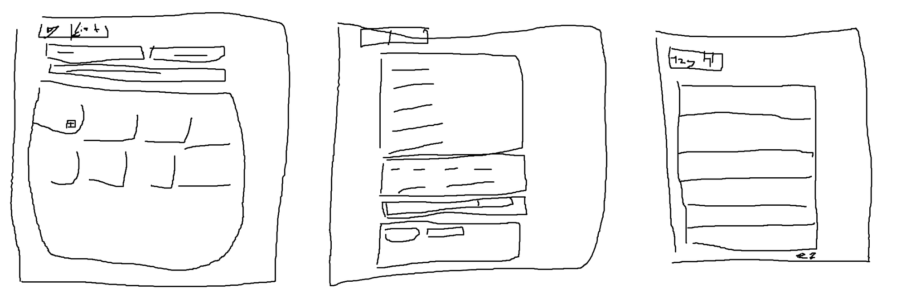

# FoodPlanner – Oberflächendesign

## Technik

React 19 mit Vite und TypeScript, React Router für die vier Seiten, TanStack Query für die
API-Aufrufe und Tailwind 4 fürs Styling. zod prüft alles, was aus dem localStorage oder aus einer
importierten Datei kommt.

Kein Next.js: Das Backend ist Spring Boot, ein zweiter Server würde nur Anfragen durchreichen.
Die Einkaufsliste liegt ohnehin im Browser, und Suchmaschinen spielen keine Rolle. Vite baut
statische Dateien, die im Docker-Setup ein einfacher Webserver ausliefert. Dieser reicht `/api` an
die API durch, genau wie Vite beim Entwickeln. Das Frontend ruft die API also immer über dieselbe
Adresse auf und braucht weder eine API-URL zur Bauzeit noch CORS.

## Abweichungen von der Spezifikation

Vorschläge, die das Team noch abnicken muss. Bis dahin gilt die Spezifikation
(`docs/2026-10-12-foodplanner-design.md`).

- API-Typen zunächst von Hand. Solange es die Endpunkte nicht gibt, lässt sich nichts generieren.
  Sobald die API ihre `openapi.json` exportiert, werden die Typen wie vorgesehen mit
  `openapi-typescript` erzeugt.
- Weniger Frontend-Tests als in der Spezifikation: Vitest für Listenlogik, Formatierung und
  Export/Import, dazu ein paar Komponententests. MSW nur dort, wo es ohne nicht geht.

## Gestaltung

Schlicht und hell, eine Akzentfarbe, Rahmen statt Schatten. Keine Farbverläufe, keine Emojis,
keine Werbetexte. Wer die App öffnet, landet direkt in der Suche. Systemschrift statt Webfont,
das spart einen zusätzlichen Download.

Die Farben stehen als Tailwind-Theme in `web/src/index.css`. Die Standardpalette ist abgeschaltet,
andere Farben gibt es nicht.

```css
@theme {
  --color-*: initial;
  --color-white: #ffffff;
  --color-surface: #fafaf7;      /* Seitenhintergrund */
  --color-panel: #ffffff;        /* Karten, Kassenbon, Felder */
  --color-line: #e4e2dc;         /* Rahmen, Trennlinien */
  --color-line-strong: #8b8e86;  /* Rahmen von Feldern und Buttons */
  --color-ink: #1d1f1c;          /* Text */
  --color-ink-muted: #5f625b;    /* Nebentext */
  --color-accent: #2f5d3a;       /* Buttons, Links, günstiger */
  --color-accent-soft: #e6eee6;  /* Hover, Konfidenz ab 90 % */
  --color-danger: #a3322a;       /* Fehler, teurer, Liste leeren */
  --color-danger-soft: #fbeeec;  /* Hintergrund von Fehlermeldungen */
}
```

- Grün heißt Aktion oder günstiger, Rot heißt Fehler oder teurer. Preisänderungen haben immer ein
  Vorzeichen, damit sie nicht nur über die Farbe erkennbar sind.
- Zahlen, die untereinanderstehen, rechtsbündig und mit fester Ziffernbreite (`tabular-nums`).
- Formate: `1,09 €`, `1,78 €/kg`, `3,4 g`, `64 kcal`, `500 g`, `1,5 l`, `27.10.2026`. Nährwerte
  „pro 100 g“ oder „pro 100 ml“, je nach `unit`.
- Einkaufsliste statt Warenkorb, Eiweiß statt Protein. Ansprache mit „du“.
- Inhalt höchstens 1024 px breit, Ecken 6 px, Abstände in 4-px-Schritten.
- Jedes Feld hat ein sichtbares Label, der Tastaturfokus ist sichtbar, Text hat mindestens
  4,5 : 1 Kontrast. Ab 360 px Breite gibt es kein seitliches Scrollen.

## Seiten



Die Seiten folgen Yaroslavs Skizzen. Für das Review gibt es keine Skizze. Screenshots kommen dazu,
sobald die Seiten stehen.

Die Kopfzeile ist auf jeder Seite gleich: links der Schriftzug, daneben Suche und Einkaufsliste
mit der Anzahl der Produkte, rechts abgesetzt Admin.

### Suche `/`

- Oben Suchfeld und Sortierung, darunter die Filter: Kategorie, Preis von/bis, Eiweiß ab. Darunter
  stehen die Zahl der Produkte im Katalog und das Datum der Preise.
- Gesucht wird 300 ms nach dem letzten Tastendruck. 8 oder 13 Ziffern sind eine EAN-Suche, im
  selben Feld.
- Suchbegriff, Filter und Seite stehen in der URL. Der Zurück-Button führt so wieder zu denselben
  Treffern.
- Die Treffer stehen als Karten im Raster, vier Spalten auf dem Desktop, eine auf dem Handy, 20 pro
  Seite. Eine Karte zeigt Name, Marke, Packungsgröße, Preis, Kilo- bzw. Literpreis und Eiweiß pro
  100 g bzw. 100 ml. Ein Bild gibt es nicht, weil die API für Produkte keins liefert.
- Der Name führt zur Detailseite, „+“ legt das Produkt auf die Liste oder erhöht die Menge um 1.

### Produktdetail `/product/:id`

- Oben Name, Marke und Kategorie, darunter Preis, Packungsgröße und Kilo- bzw. Literpreis, daneben
  Menge und „Zur Liste hinzufügen“. Abweichend von der Skizze steht das oben, damit man dafür nicht
  scrollen muss.
- Darunter Nährwerte pro 100 g bzw. 100 ml und Preisverlauf als Tabellen, auf dem Desktop
  nebeneinander. Ohne abgelösten Preis steht dort „Bisher keine Preisänderung“.
- Am Ende EAN, Abteilung und die Links zu Aldi und Open Food Facts, jeweils nur, wenn es sie gibt.

### Einkaufsliste `/list`

- Die Liste sieht aus wie ein Kassenbon: Monospace-Schrift, gestrichelte Trennlinien, Summe
  unten. Das passt zu Yaroslavs Skizze und zum Drucken.
- Jede Zeile hat Name, Mengenschalter, Stückpreis und Zeilensumme, dazu Eiweiß und kcal pro 100 g
  bzw. 100 ml und die Differenz, falls sich der Preis seit dem Hinzufügen geändert hat. Unter den
  Zeilen stehen Summe, Preisänderung insgesamt und die Summen der Nährwerte.
- Neben dem Bon die Ziele mit Fortschrittsbalken, auf dem Handy darunter. Ziele gibt es nur
  komplett: Ein Schalter „Ziele verwenden“ blendet die fünf Felder ein, alle mit Vorschlagswerten.
  Das Budget wird in Euro mit Komma eingegeben und in Cent gespeichert. Über 100 % wird nur das
  Budget rot, weil bei Nährwerten offen ist, ob ein Ziel Minimum oder Maximum ist.
- Oben Exportieren, Importieren und Drucken. Importieren ersetzt Liste und Ziele und fragt vorher
  nach, wenn die Liste nicht leer ist. „Liste leeren“ fragt immer nach. Beim Drucken fallen
  Buttons, Mengenschalter und Ziele weg.
- Alle Summen rechnet der Server. Während neu gerechnet wird, bleiben die alten Zahlen stehen.
- Produkte, die nicht mehr im Katalog sind, stehen unter dem Bon mit ihrem gespeicherten Namen und
  einem eigenen „Entfernen“.

### Review `/admin`

- Oben das Feld für den Admin-Schlüssel, er gilt nur für die aktuelle Browsersitzung. Darunter die
  Tabs „Zu prüfen“ und „Ohne Treffer“.
- „Zu prüfen“ hat Filter für Kategorie und Konfidenz. Jeder Block zeigt oben die gescrapte Zeile
  mit Name, Preis und Link zur Aldi-Seite, darunter bis zu fünf Kandidaten mit Konfidenz und
  „Übernehmen“, am Ende „Keiner passt“.
- Nur der beste Kandidat eines Blocks hat eine Checkbox. „Alle ab 90 % auswählen“ hakt die
  passenden an, „Auswahl bestätigen“ schickt sie ab. Danach steht da, was übernommen wurde und was
  nicht, mit Grund.
- Bilder erscheinen als Vorschau, wenn man mit der Maus über einen Namen fährt oder ihn mit der
  Tastatur auswählt.
- In „Ohne Treffer“ hat jede Zeile ein Feld für die Open-Food-Facts-URL und „Verknüpfen“.

## Laden, leer, Fehler

- Beim ersten Laden steht „Lädt …“ da. Danach bleibt der alte Inhalt sichtbar, bis neue Daten
  da sind. Keine Ladekreisel über dem Inhalt.
- Leere Liste oder keine Treffer: ein Satz und eine passende Aktion, z. B. „Filter zurücksetzen“.
- API-Fehler zeigen `title` und `detail` aus dem `ProblemDetail` über dem Inhalt. Was schon
  da ist, bleibt bedienbar.
